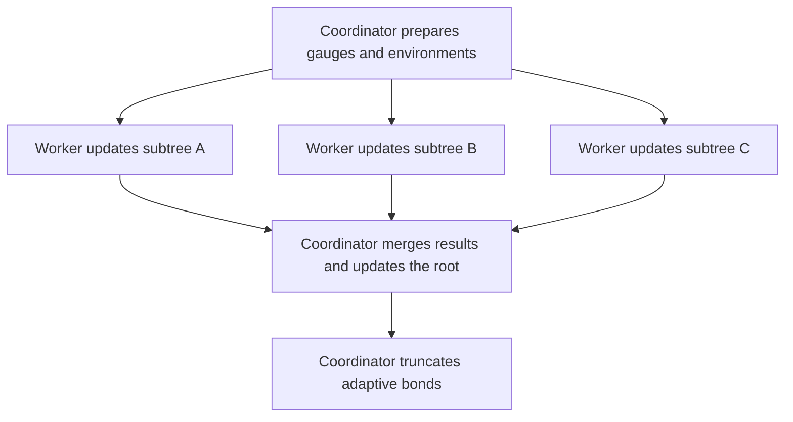

# MPI parallelization of BUG

`MPIBUG` distributes **the subtree updates of one Basis-Update and Galerkin
(BUG) time step**. One MPI rank, the **coordinator**, owns the full tree tensor
network state (TTNS) and Hamiltonian (TTNO). Other ranks run the existing
serial BUG update on separate subtrees. The coordinator assembles their
results into the next state before starting the next time step.

## How a time step is split

The **frontier** is a cut through the tree: each frontier node is the root of
one worker task, and its descendants belong to that task. The scheduler starts
with the children of the tree root. If it needs more tasks, it follows
single-child paths to find further branch points and splits a large subtree
there. `subtree_tasks` is a target: the actual frontier can be smaller if the
tree offers too few branches, or larger if splitting a node adds several
children at once. A chain does not turn into several independent tasks by
allocating more MPI ranks.



1. **Prepare.** The step starts with the orthogonality center at the root. The
   coordinator copies the working state, builds the root's contraction cache,
   and prepares the original gauges and environments down to the frontier.
   These environments carry the effect of the rest of the tree into each
   local update, including Hamiltonian terms that cross the cut.
2. **Update.** Each worker receives its subtree, the tensors needed at the
   parent boundary, the necessary metadata, and the relevant environments.
   It runs the same recursive `update_node` kernel as serial BUG and returns
   updated tensors, the basis change on the outgoing bond, and the contracted
   environment needed by the parent.
3. **Assemble.** The coordinator merges results as they arrive. After all
   frontier tasks finish, it updates the ancestors from the bottom up and
   evolves the root using the new child bases. For adaptive `MPIBUG`, it then
   truncates bonds by SVD and returns the orthogonality center to the root.
   `MPIFixedBUG` uses the same dispatch and merge scheme with fixed-rank local
   updates and no adaptive truncation pass.

The public classes live in [`time_evolution.mpi_bug`](../pytreenet_lasyten/time_evolution/mpi_bug.py).
The [compact worker implementation](../pytreenet_lasyten/time_evolution/_mpi_bug_fast.py)
handles scheduling and transport; the
[shared BUG kernels](../pytreenet_lasyten/time_evolution/time_evo_util/common_bug.py)
handle the tensor updates.

## Launching a run

Use the same Python environment and MPI runtime on all ranks. All ranks enter
`MPICommExecutor` on the same communicator. Only its root gets an executor
and should construct the TTNS, TTNO, and integrator. Reuse that executor for the
whole trajectory:

```python
from mpi4py import MPI
from mpi4py.futures import MPICommExecutor
from pytreenet_lasyten.time_evolution.bug import BUGConfig
from pytreenet_lasyten.time_evolution.mpi_bug import MPIBUG
from pytreenet_lasyten.time_evolution.time_evolution import TimeEvoMode


def evolve_mpi(build_problem, dt, final_time, chi, comm=MPI.COMM_WORLD):
    """Call on all ranks. build_problem() returns the initial TTNS and TTNO."""
    with MPICommExecutor(comm, root=0) as executor:
        if executor is None:
            return None

        state, hamiltonian = build_problem()
        config = BUGConfig(
            max_bond_dim=chi, rel_tol=1e-10, total_tol=1e-12,
            time_evo_mode=TimeEvoMode.RK45, subtree_workers=1,
        )
        evolution = MPIBUG(
            state, hamiltonian, dt, final_time, {},
            config=config, solver_options={"rtol": 1e-8, "atol": 1e-10},
            executor=executor, subtree_tasks=3,
        )
        evolution.run()
        return evolution.state
```

For a three-arm tree, start with **four ranks: one coordinator and three
workers**. Keep `config.subtree_workers=1`; the MPI allocation supplies the
worker processes, while `subtree_tasks` sets the target number of tasks per
step. To evolve addition and removal independently *and* parallelize within
both sectors, split the world communicator into two four-rank groups and use
one executor per group. The [two-rank HK example](../examples/hk/README.md)
instead runs one serial BUG trajectory per sector.

## What the workers store

The coordinator holds the full network. Worker messages contain only the
tensors and metadata needed for their subtree updates. The compact codec
supports NumPy and CPU LASyTen tensors with bosonic `U(1)` or `U(1) × U(1)`
symmetry. It sends the allowed numerical blocks and leg/charge records, then
reconstructs the native tensors on the receiving rank. It does not densify the
native tensors or use HDF5 for these messages. The older full-tree transport
is available under `LegacyMPIBUG` and `LegacyMPIFixedBUG`.

Each worker caches up to eight immutable Hamiltonian fragments. The executor
does not guarantee that a subtree returns to the same worker; a worker that
misses the cache requests the fragment and the coordinator resubmits the task.
Ordinary tensor assignments through `H.tensors[node_id]` invalidate tracked
fragments. After an **in-place edit** to coefficients or blocks, call
`evolution.invalidate_worker_hamiltonian()`. Use
`cache_hamiltonian=False` to disable caching explicitly; it is also bypassed
when the time-dependent configuration is enabled.

## Checking correctness and scaling

From the backend project directory, run the
[smoke test](../examples/mpi_bug_smoke.py) and the
[serial/MPI benchmark](../examples/benchmark_workers.py):

```bash
export OMP_NUM_THREADS=1 OPENBLAS_NUM_THREADS=1 MKL_NUM_THREADS=1
mpiexec -n 3 python -m examples.mpi_bug_smoke --backend numpy --verify
mpiexec -n 4 python -m examples.benchmark_workers --executor mpi \
    --backend numpy --subtree-tasks 3 --warmup 3 --steps 5
```

Use the launcher appropriate to your cluster allocation. With LASyTen
installed, use `--backend lasyten` for the smoke test. For a representative
native benchmark, use `--backend u1` or `--backend u1xu1` with the HK helpers
accessible via `--helper-dir`. Compare serial and MPI results using the same
initial state, time step, solver tolerances, and bond cap. Check the norm and
overlap phase as well as the fidelity, which is insensitive to global phase.

`evolution.last_worker_stats` describes the latest step:

| Fields | What to check |
| --- | --- |
| `frontier`, `tasks` | Number of subtrees and the spread of worker compute times |
| `task_bytes`, `hamiltonian_bytes`, `result_bytes` | Bytes serialized for task inputs, Hamiltonian fragments, and results |
| `cache_misses` | How often workers request Hamiltonian fragments after warm-up |
| `initial_cache_seconds`, `coordinator_finish_seconds`, `truncation_seconds` | Time spent in phases that remain on the coordinator; truncation is reported for adaptive BUG |
| `step_seconds` | Elapsed time for the whole step; compare this to serial BUG |

Worker timings can overlap each other and coordinator work, so adding them
does not give elapsed time. A worker's `process_peak_rss_mib` is its lifetime
peak resident memory; adding these peaks does not measure simultaneous job
memory. Use concurrent process or node measurements for that comparison.

Speedup is limited by how well the frontier balances the work, the cost of
transport, and the work left on the coordinator. The scheduler initially
prioritizes large subtrees by tensor size and then uses measured compute times.
If one branch dominates or root updates and truncation take most of the step,
adding workers may have little effect. Benchmark several warmed-up steps on a
tree and bond dimensions close to the intended run.
